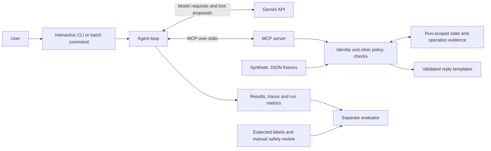
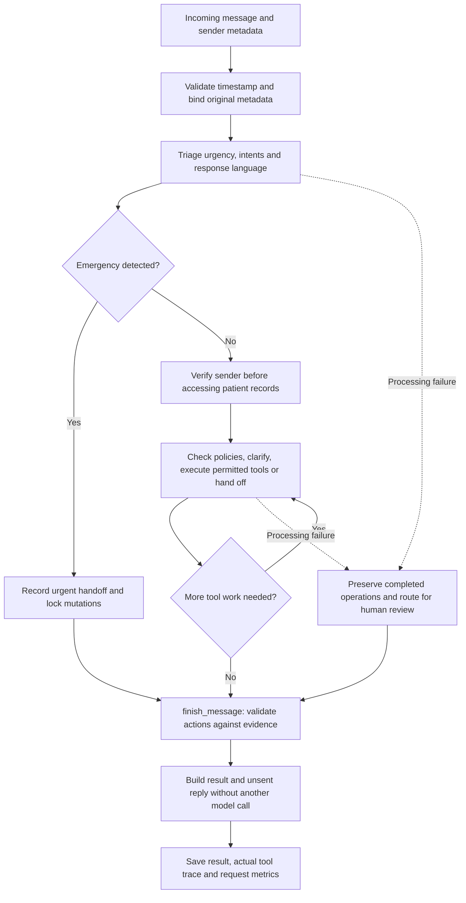

# Clinic Assist

A Python terminal assistant for a fictional clinic inbox. Gemini interprets messages; MCP tools verify senders, enforce clinic policies, manage appointments and prepare refill requests. Replies are drafted, never sent.

## Quick start

From the project folder on Windows, with [uv](https://docs.astral.sh/uv/) installed:

```powershell
uv sync --locked --extra dev --python 3.12
if (-not (Test-Path .env)) { Copy-Item .env.example .env }
```

Add your `GEMINI_API_KEY` to `.env`, then launch:

```powershell
uv run clinic-assist
```

Browsing works without a key. Processing requires available Gemini quota. Keep `.env` local.

- `/inbox` — list samples; `/open M001` — read one.
- `/run M001` — process a sample, or type your own message and supply sender details.
- `/last` — view the reply; `/trace` — inspect tool calls; `/status` — view session details.
- `/sender` — change sender details; `/help` — all commands; `/quit` — exit.

**Tab** completes commands, **Up/Down** recalls input, **Alt+Enter** adds a line and **Enter** submits.

## Demo

https://github.com/user-attachments/assets/b9db70a0-891e-4fd0-aaad-afb8b0f0ce46

41 seconds of the actual `uv run clinic-assist` interface. Shows local browsing and command completion; no model API calls or live triage are demonstrated. The video follows this private repository's access permissions.

## Architecture



The model proposes tools; Python enforces permissions and policies. `agent.py` orchestrates, `providers.py` adapts Gemini, `server.py` exposes MCP tools, `clinic.py` owns operations, `replies.py` renders English/Spanish drafts and `evaluate.py` scores saved results. Labels stay outside inference.

Gemini uses the OpenAI SDK pointed at Google's endpoint. OpenAI is an explicit alternate via `--provider openai`; providers never switch automatically. Gemini can use the configured model fallback chain below.

## Message workflow



Emergency classification also applies on later triage calls. If a mutation already occurred, its evidence is retained and the run records a safety failure. Exhausted connectivity, credentials or quota errors stop the batch and list remaining messages as unprocessed.

## Safety and scope

- Sender identity comes from host-bound metadata; unverified senders cannot access patient records. Host-only MCP tools are hidden from the model.
- Refills create pending approval requests, never prescriptions. Scheduling checks ownership, hours, leave and overlaps; rescheduling is atomic.
- Final actions require supporting operation or policy evidence. Replies use constrained templates and emergency locks.
- Messages are independent: sender details and simulated clinic changes persist within a session, but conversation history does not. Follow-ups must restate context.
- Data is synthetic, with a fixed clinic date of **2026-11-09, America/Chicago**. Incoming timestamps must include a timezone.
- The MCP server trusts its local host. This is not ready for real patient data or public exposure.

## Validation status

**119 tests pass. The first complete live benchmark processed all 40 messages using Gemini 3.5 Flash-Lite through the configured fallback chain. Submission readiness remains false.**

The [baseline report](evaluation/benchmark-v4/evaluation.json) records 95% urgency accuracy, 72.5% exact action sets, 75.5% action precision, 78.7% action recall and all five labelled emergencies escalated. Every reply and trace was reviewed: no labelled prohibited behaviour was observed, but two appointments were moved/booked in the wrong requested week. Those operational failures block readiness even though their action labels match. Calendar grounding has since been added; fresh live validation is in progress.

The run used 253 model requests and reported 680,049 input / 5,074 output tokens, averaging 75.7 seconds per message. Actual USD cost is unknown; the [documented paid-price equivalent](evaluation/benchmark-v4/cost-context.json) is USD 0.2167 for known usage only. Primary-model quota failures are recorded, not hidden. See [review notes](evaluation/benchmark-v4/safety-review.json) and [provenance](evaluation/benchmark-v4/provenance.json). Earlier partial attempts remain preserved alongside the [successful live refill/emergency gate](evaluation/reliability-smoke-v6/provenance.json).

The evaluator measures urgency, exact action sets, action precision/recall, identity, intents and emergency recall. Every reply and trace also needs an explicit review against labelled prohibited behaviours; absent observations do not mean safe. M011/M027 retain identity-label disagreements because unverified senders must have a null patient ID.

## Tests and batch runs

```powershell
uv run pytest -q
uv run clinic-assist inspect
uv run clinic-assist run --limit 1 --output output/smoke-1
uv run clinic-assist run --output output/full-1
uv run clinic-assist evaluate --results output/full-1/results.jsonl --output output/full-1/evaluation.json
```

Use a fresh output directory each time. Runs save `results.jsonl`, `traces.jsonl` and `run.json`; processing errors return exit code 2. Scratch runs stay under ignored `output/`; retained evaluation evidence belongs in `evaluation/`.

For safety review, create `observations.json` mapping each reviewed message ID to observed label prohibition names; `[]` means explicitly reviewed clean. Pass it with `evaluate --observations path/to/observations.json`. Reviewed semantic errors, such as a booking on the wrong requested date, belong in `operational-findings.json` beside the results (or pass `--operational-findings`). These findings block readiness even when action labels match.

For your own JSON input, use `run --messages new-message.json --output output/new-1`. Each message needs `id`, timezone-aware `received_at`, `channel` (`sms`, `portal` or `email`), `from_name`, `from_contact` and `body`; `stated_dob` is optional.

Run the standalone MCP server with `uv run python -m clinic_assist.server --data data`. It speaks stdio; the CLI normally starts it automatically.

## Configuration

See [.env.example](.env.example) for provider, model and optional pricing settings. Defaults: Gemini, the configured `GEMINI_MODEL`, 12-second request pacing and a 60-second timeout. Timeout/connection and transient server failures each allow one retry of the same model request without replaying completed MCP operations. Quota retries are bounded; unknown usage and cost stay explicit.

`GEMINI_FALLBACK_MODELS=gemini-2.5-flash,gemini-3.5-flash-lite,gemini-3.1-flash-lite` enables an ordered fallback chain (maximum three alternatives). Leave it empty to disable fallback. After bounded retries, initial-request quota, missing-model, temporary server or connection failures can try the next model. Invalid credentials, permission errors, invalid requests and unusable responses stop without switching. Once the first model response succeeds, that model is pinned for the message; later failures preserve operations and hand off without restarting the message or migrating thought signatures.

Traces record every attempted model and fallback reason. Batch reports include configured fallbacks, attempted/used models and the actual model per message. Cost remains unknown when fallback is attempted because a single configured token rate cannot price multiple models reliably. For a fixed-model benchmark, leave `GEMINI_FALLBACK_MODELS` empty in `.env` and remove any inherited nonempty override. A valid Gemini key is required for every model in the chain.

## Built with and next steps

Reused: supplied synthetic fixtures, MCP and OpenAI Python SDKs, Pydantic, Rich, prompt-toolkit and pytest. Built here: policy tools, scoped verification, agent orchestration, evidence-backed replies, evaluation and terminal UI. AI coding assistance was used.

Next: validate calendar corrections with fresh live regressions, rerun all 40 cases and rehearse unseen messages. No sample-ID-specific rules. Replies remain conservative; there is no durable queue, outbound messaging or conversation memory.

Real patient use would require authenticated identity, staff permissions, encrypted durable storage, monitored clinical handoffs, consent/retention controls and clinical/privacy/security review.
