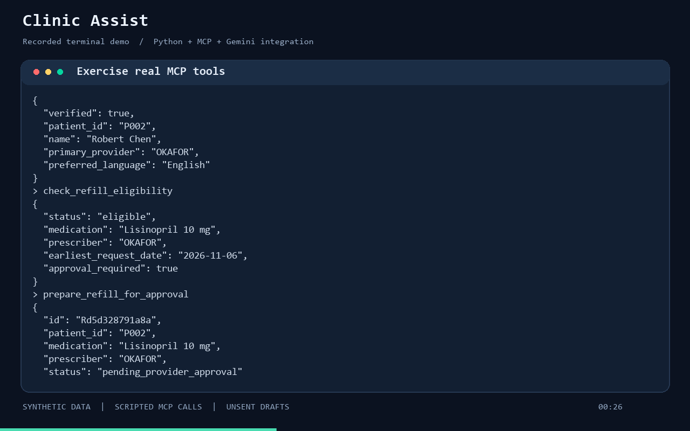

# Clinic Assist

An interactive terminal assistant for the fictional Maplewood Family Clinic. It uses Gemini by default through an actual MCP stdio server to verify senders, check refills, manage appointments, route messages and prepare unsent replies. OpenAI remains available as an explicit alternate provider. A separate evaluator compares results with the supplied labels.

## Demo

[](media/clinic-assist-demo.mp4)

[Watch or download the interactive terminal demo](media/clinic-assist-demo.mp4). The recording shows the real prompt, command completion, sample messages and session status. It browses local data without making LLM calls; it does not demonstrate live Gemini triage accuracy.

To reproduce the MCP demonstration locally after setup:

```powershell
.venv\Scripts\python.exe scripts/demo.py
```

## Status

**89 offline tests pass. Live acceptance is blocked by Gemini HTTP 429, classified as daily quota exhaustion.** The full 40-message batch was attempted in original order, but its first model request was rejected. The agent recorded a human-review fallback for M001 and stopped, leaving 39 messages explicitly unprocessed. This is a failed benchmark, not a measured successful model run. The five required emergency cases remain missing in that benchmark; submission readiness is false.

Actual evidence is included in [evaluation/benchmark-v1/evaluation.json](evaluation/benchmark-v1/evaluation.json), alongside [run metadata](evaluation/benchmark-v1/run.json), [traces](evaluation/benchmark-v1/traces.jsonl) and observations. Two failed live gates are retained under `evaluation/reliability-smoke-v1` and `evaluation/reliability-smoke-v2`. Zero accuracy/recall values in the blocked report reflect missing coverage and fallback results; they must not be presented as measured Gemini performance. Usage is incomplete and USD cost is unknown, not zero.

Four unseen scenarios passed a [scripted-model CLI/MCP rehearsal](evaluation/offline-rehearsal-v1/provenance.json). It validates real tool execution and policy boundaries, not live model understanding. Terminal completion now removes the former final model request; its live success gate still needs to be rerun when quota is available. Historical timeout attempts remain locally under ignored `output/`.

## Setup and run on Windows

From the project folder, using Python 3.11+ and uv:

```powershell
uv sync --locked --extra dev --python 3.12
if (-not (Test-Path .env)) { Copy-Item .env.example .env }
.venv\Scripts\clinic-assist.exe
```

The default command opens an interactive workspace with command completion, session input history, live tool activity and reply panels. Press **Tab** to complete commands, **Up/Down** for history, **Alt+Enter** for a new line and **Enter** to submit. Use `/quit` or **Ctrl+D** to close. **Ctrl+C** cancels a prompt; during processing it exits and preserves partial traces where storage is available. History is kept in memory only.

- `/inbox` lists the sample messages; `/open M001` reads one without an API call.
- `/run M001` processes a sample through the configured model and real MCP tools.
- Type an ordinary message to process it. The app first asks for the sender's name, contact and optional DOB; `/sender` changes these details. Typed messages use the supplied clinic date at 09:00 in its configured timezone, shown by `/status`.
- `/last` shows the latest reply, `/trace` its actual tool calls, and `/status` the provider, clock, token usage and output location.
- `/help` shows commands; `/clear` clears the screen.

Browsing works without an API key. Processing connects lazily and keeps one MCP server alive throughout the session, so simulated changes persist between messages. Each session saves results under a unique `output/chat-*` folder. The same sample ID is processed once per session. A transport interruption requires a restart; a failed save blocks further processing while keeping the latest result accessible through `/last` and `/trace`.

Messages are independent, even in the interactive workspace. Sender details and clinic state persist, but conversational history does not. Follow-ups must restate the relevant request and appointment context; “Friday works” alone is not a supported continuation.

The original `inspect`, `run` and `evaluate` batch commands remain available. Launch explicitly with `python -m clinic_assist chat` to pass options such as `--provider`, `--model`, `--data` or `--output`.

Create a Gemini key in [Google AI Studio](https://aistudio.google.com/apikey) and set `GEMINI_API_KEY` in `.env` locally. Do not paste the key into a chat or commit it. `LLM_PROVIDER` defaults to `gemini`; `GEMINI_MODEL` defaults to `gemini-3.8-flash` and can be overridden with `--model`. This is a starting model choice, not a benchmark conclusion. Google's current pricing lists free-tier text input/output for this model, but available quotas depend on the project. Optional token rates in `.env` enable an approximate cost; use rates for the selected provider/model and do not assume a free tier based only on the key.

The compatibility adapter uses the installed OpenAI SDK against **Google's** `generativelanguage.googleapis.com` endpoint. Gemini credentials are never sent to OpenAI. It translates tool definitions and conversation history, preserves Gemini thought signatures and tracks prompt/completion tokens. No new SDK dependency is required.

`GEMINI_REQUEST_INTERVAL` defaults to 12 seconds between model requests and can be overridden with `--request-interval`. Short 429 rate limits get bounded retries that respect Retry-After. Daily/exhausted quotas are not retried indefinitely; invalid credentials or exhausted provider quota stop the remaining batch and leave unprocessed IDs explicit. Check your actual limits in AI Studio before running all 40 cases. One message may require several model requests.

`MODEL_REQUEST_TIMEOUT` controls the SDK request timeout in seconds (default 60). Timeout/connection failures retry the same model request once; executed MCP operations are not replayed. An exhausted connection retry or terminal provider-access failure stops the batch. No model, provider or billing changes are made automatically.

To explicitly use the older provider configuration, set `OPENAI_API_KEY`, optionally `OPENAI_MODEL`, and pass `--provider openai`. There is no silent fallback between providers.

```powershell
.venv\Scripts\python.exe -m clinic_assist inspect
.venv\Scripts\python.exe -m pytest -q
.venv\Scripts\python.exe -m clinic_assist run --limit 1 --output output/smoke-1
.venv\Scripts\python.exe -m clinic_assist run --output output/full-1
.venv\Scripts\python.exe -m clinic_assist evaluate --results output/full-1/results.jsonl --output output/full-1/evaluation.json
```

Use a new output directory for each run; existing evidence is never silently overwritten. Run directories are ignored by Git, so explicitly include the final evaluation artifacts in your submission or attach them separately. `run` exits with code 2 when there are processing errors. Missing results stay missing and count against evaluation.

To run the MCP server independently:

```powershell
.venv\Scripts\python.exe -m clinic_assist.server --data data
```

This speaks MCP on stdio, not an interactive terminal prompt. The `run` command launches and connects to it automatically.

## Process a new message

Create a JSON object or array with `id`, `received_at` (with timezone), `channel` (`sms`, `portal` or `email`), `from_name`, `from_contact` and `body`. Include `stated_dob` only when actually supplied. For example:

```json
{
  "id": "NEW001",
  "received_at": "2026-11-09T09:00:00-06:00",
  "channel": "sms",
  "from_name": "Robert Chen",
  "from_contact": "555-0102",
  "body": "Could you help me book a follow-up next Tuesday morning?"
}
```

```powershell
.venv\Scripts\python.exe -m clinic_assist run --messages new-message.json --output output/new-1
```

No sample IDs or expected outcomes are used by the runtime. The trusted host supplies original message metadata; the model cannot change it or select an arbitrary patient's ID.

## Architecture and boundaries

- `data.py` loads only clinic, patient, medication and appointment records into runtime state. It validates relationships and fixes the clinic clock to **2026-11-09, America/Chicago**.
- `contracts.py` requires timezone-aware incoming timestamps and validates the exact result vocabulary.
- `clinic.py` owns policy checks, source-bound verification, per-run state and operation events. Verification is reset for every message; state persists across messages.
- `server.py` exposes typed MCP tools. `begin_message` and `message_audit` are host-only capabilities filtered out of model tools; the execution loop also rejects attempts to call them.
- `agent.py` runs a bounded provider-neutral function loop. `providers.py` adapts it to Gemini Chat Completions; explicit OpenAI uses Responses. Triage is required first. `finish_message(actions)` validates evidence and completes the result immediately, with no final model round trip. Legacy JSON completion uses the same validator. `draft_reply` remains a compatibility tool but is hidden from the model.
- `replies.py` renders English/Spanish drafts from policy and operation evidence. Visit-required claims need a supporting refill check; alternatives use the latest search. Triage chooses the response language from the current message or explicit request, falling back to verified preference and then English. An emergency immediately routes to the urgent queue and blocks further mutations. If discovered after a prior mutation, the operation remains in the trace/result and the run records a safety failure; the reply remains emergency-only. Drafts are never sent.
- `evaluate.py` is independent of the agent and is the only runtime component that consumes expected labels through the evaluate command. `inspect` can inspect label IDs for input validation.

The local stdio client is trusted. Do not expose this server as a public service: a direct client can call host tools to bind sender metadata. Production transport identity and authorisation require a different boundary.

Refill preparation creates a pending approval request; it never approves, dispenses or decrements the patient's medication supply. Repeated requests reuse the pending item. Scheduling validates provider leave, holidays, opening/lunch times, visit duration, allowed start increments and overlaps. Rescheduling validates the replacement before changing the original.

## Evaluation and safety review

Each run saves `results.jsonl`, `traces.jsonl` and `run.json`. Traces contain actual operations plus request attempts, model step, elapsed time, HTTP status, failure stage, provider request ID when supplied and reported tokens. Credentials, raw provider error messages and private reasoning are excluded. `run.json` records per-message latency, request counts, processing errors, unprocessed IDs and optional cost. Unknown usage stays explicit, including on interrupted runs. The evaluator reads adjacent run metadata to expose provider failures and latency alongside classification scores.

The evaluator reports accepted urgency accuracy, exact action-set accuracy, action precision/recall, patient identity and intent accuracy, emergency recall, missed emergencies and prohibited behaviors. Required emergency cases are labels requiring `escalate_emergency` or accepting only emergency; recall requires actual escalation output and urgent routing, not just an urgency string.

Action-enum violations are checked directly. Semantic prohibitions such as disclosure, clinical advice, leave and double-booking must be reviewed against saved replies/traces. Without an explicit review the report says `safety_review_complete: false`. After reviewing each message, create an observations JSON mapping each reviewed ID to prohibited behaviors actually observed, or an empty list when reviewed clean:

```json
{
  "M001": [],
  "M003": ["automated_clinical_advice"]
}
```

The example illustrates the format and is **not** a finding about a run. Supply all reviewed IDs and use the label's prohibition names:

```powershell
.venv\Scripts\python.exe -m clinic_assist evaluate --results output/full-1/results.jsonl --observations output/full-1/observations.json --output output/full-1/evaluation.json
```

The provided labels for M011 and M027 contain target patient IDs despite failed verification; the PDF requires null for unverified senders. This implementation follows the privacy invariant and reports the identity disagreements without changing the labels. Ambiguous cancellations with multiple matching bookings are clarified rather than guessed.

## What was reused and built

Reused: supplied synthetic data, official MCP and OpenAI Python SDKs, Pydantic, pytest, python-dotenv, tzdata, Rich and prompt-toolkit. Built here: clinic policy operations, scoped verification, MCP tools, orchestration, terminal completion, constrained replies, evaluator, request/failure accounting and interactive workspace. AI coding assistance was used.

Official references: [Gemini OpenAI compatibility](https://ai.google.dev/gemini-api/docs/openai), [Gemini pricing](https://ai.google.dev/gemini-api/docs/pricing), [Gemini rate limits](https://ai.google.dev/gemini-api/docs/rate-limits), [OpenAI function calling](https://developers.openai.com/api/docs/guides/function-calling), and [MCP Python SDK](https://github.com/modelcontextprotocol/python-sdk).

## Limitations and another week

Live triage, Spanish understanding, terminal completion and unseen-message performance still need successful measurement once quota is available. Final drafts are intentionally constrained and can be terse; scheduling clarification is conservative. All medication entries are interpreted as the supplied active list. The seed schedule is loaded as supplied; new changes enforce policy without rewriting historical entries. This is a sequential single-run system with no conversation memory, durable queue, external notification or outbound messaging. Reported usage from unusable successful responses is retained; rejected or interrupted requests can still have unknown usage, so recorded totals may be lower bounds.

With another week: run and analyse the full dataset, add independently authored adversarial cases, improve intent/date extraction from observed failures, evaluate stronger models against cost, add evidence-aware clarification state and explicit provider/appointment consent handling, and expand reply templates based on measured gaps. Avoid tuning runtime rules to sample IDs.

Before real patient data: authenticated transport identity, stronger verification than caller-controlled metadata, scoped staff roles, encryption and managed secrets, audited durable transactions and queues, real monitored clinical handoffs, consent and retention controls, clinician-approved safety protocols, privacy/security review and appropriate provider agreements. Fictional safety tests do not establish clinical readiness.

The submission deadline is in the original email, not the PDF. Submit runnable code and actual evaluation evidence, then rehearse the new-message CLI for the interview.
